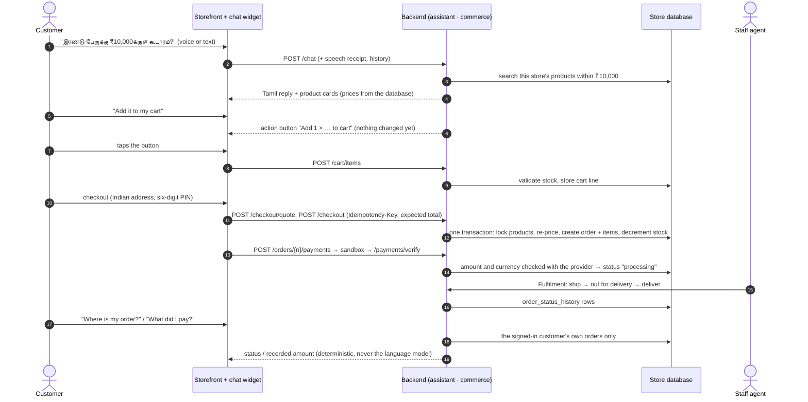
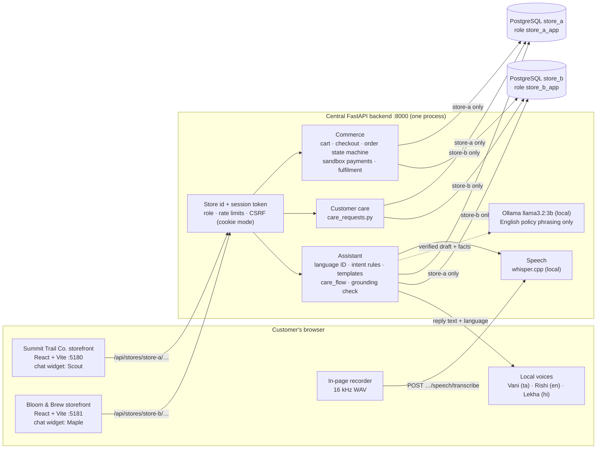
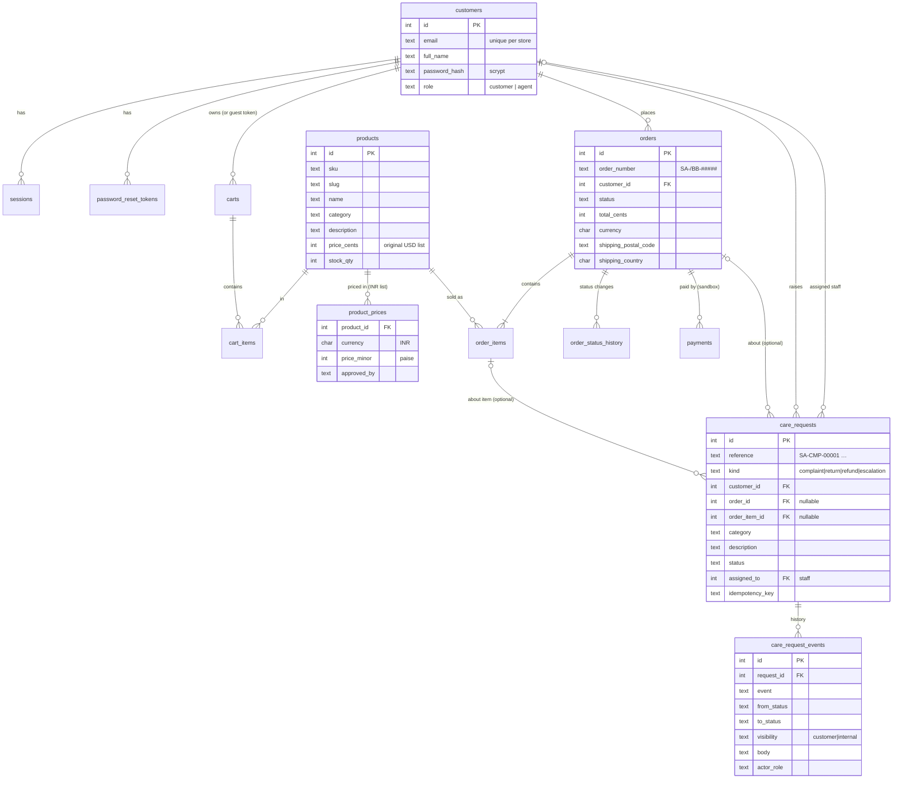
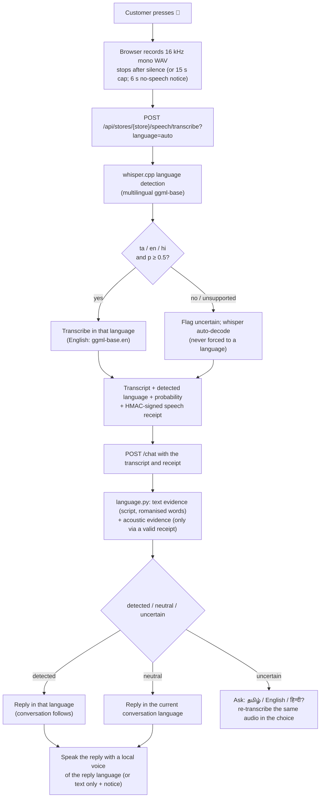
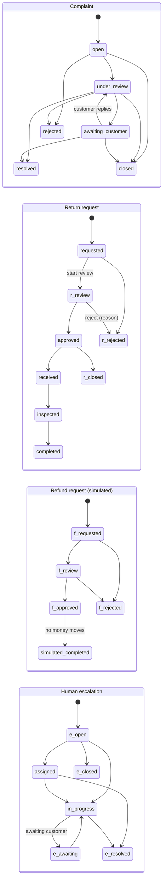
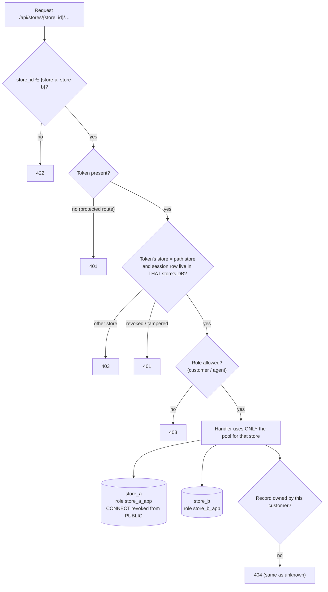

# AI Voice Commerce — Project Report

*Final-year engineering project. Multilingual (Tamil, English, Hindi), voice-first conversational commerce for two
independent online stores, with one locally hosted AI customer-service assistant. An academic system, not a
commercial product: all customers, orders and payments are synthetic, prices are an academic demonstration list, and no
real money, courier, refund or messaging service is connected.*

This report summarises the system and links to the detailed documents rather than repeating them:
[`README.md`](../README.md) (setup, security model, API overview), [`voice.md`](voice.md) and
[`voice-testing.md`](voice-testing.md) (speech), [`customer-care.md`](customer-care.md) (assistant behaviour and care
workflows), [`security.md`](security.md), [`database-safety.md`](database-safety.md),
[`migration-runner-safety.md`](migration-runner-safety.md), [`fulfilment.md`](fulfilment.md),
[`india-readiness.md`](india-readiness.md), [`testing-plan.md`](testing-plan.md) and the demonstration script in
[`demo-guide.md`](demo-guide.md).

---

## 1. Abstract

Online shops in India mostly serve customers through English-only text interfaces, while many customers would rather
speak, and speak Tamil or Hindi. This project builds two independent storefronts — **Summit Trail Co.** (outdoor gear,
assistant **Scout**) and **Bloom & Brew** (coffee and tea, assistant **Maple**) — served by one central backend whose
assistant can be spoken to or typed to in **Tamil (default), English or Hindi**. It identifies the language of every
utterance, keeps the conversation's context when the customer switches language, and answers questions about products,
INR prices and budgets, the cart, orders and payments. It also registers four customer-care requests by conversation:
complaints, return requests, **simulated** refund requests and requests for a person, and staff handle these on a dashboard.

Everything runs locally: speech recognition with whisper.cpp, an optional local language model (Ollama, `llama3.2:3b`)
for phrasing English policy answers, and macOS voices for speech output. Answers that involve facts (prices, stock,
orders, request references) come from fixed, parameterised database queries and reviewed templates, never from the
language model. Each store has its own PostgreSQL database and database role. On fixed evaluation sets the system
answered every price and recommendation query in the set correctly and registered every scripted care request (§16),
but these sets are small and written by the developer. The weakest part is Tamil speech recognition with the small
`base` model; native-speaker validation has not been done (§17).

## 2. Problem statement

1. **Language barrier.** Customer service in Indian e-commerce is mostly English text. Customers who prefer Tamil or
   Hindi, or who switch between languages mid-sentence, are poorly served.
2. **Typing barrier.** Voice is more natural for many users (older customers, users with low literacy or motor
   impairments, people on phones), but most shop assistants are text-only.
3. **Trust.** General-purpose chatbots invent prices, policies, order states and refund confirmations. A shop assistant
   must never state a fact the shop's own records do not support.
4. **Privacy and cost.** Cloud speech and language APIs send customers' voices and data to third parties and cost money
   per request. A student project, and many small shops, need a local alternative.
5. **After-sales care.** Complaints, returns, refunds and requests for a person usually go to e-mail with no reference
   number or visible status. That is the point where customers lose trust.

## 3. Objectives

| # | Objective | Where it is met |
|---|---|---|
| O1 | Voice and text conversation in Tamil (default), English and Hindi, with per-utterance language identification and mid-conversation switching | §11, `voice.md` |
| O2 | Product discovery, comparison, INR budget filtering and cart actions by conversation | §12 |
| O3 | Factual answers only from the store's own database (no invented prices, orders or policies) | §12, §14 |
| O4 | Four customer-care workflows, registered by form or by conversation, with staff handling and customer-visible status | §13 |
| O5 | Strict isolation between the two stores | §14 |
| O6 | Local processing only (speech, language model, voices) | §6, §11 |
| O7 | Repeatable automated testing and measured evaluation | §15, §16 |

## 4. Proposed system

Two React storefronts share one FastAPI backend. Each store has its own branding, catalogue, customers, orders,
policies and assistant persona, and its own database. The chat widget on every page accepts typed or spoken input. Spoken input is
recorded in the browser and transcribed by the store's own backend with whisper.cpp. The backend:

1. identifies the language from the transcript and a signed acoustic result (`app/assistant/language.py`);
2. detects intents with rules (`app/assistant/intent.py`): product search, budget, cheapest, compare, attribute,
   add to cart, order status, order amount, payment, policies, care requests, and more;
3. reads facts through fixed repository functions for **this store only**;
4. composes the answer from reviewed Tamil / English / Hindi templates (`care_text.py`, `i18n.py`);
5. for English policy, greeting and contact questions only, may let the local model rephrase the verified draft, then
   rejects the model's text if it adds anything not in the facts (`AssistantService.grounded`);
6. proposes actions (add to cart, view a request, confirm a care request) that the customer must tap or confirm.

Customer-care requests are stored in two new tables, have store-specific references (e.g. `SA-RET-00001`), follow
explicit state machines, and appear in a staff dashboard (§13).

**Customer request and order workflow** (one store; every step stays inside that store's database):



## 5. System architecture



A background worker (`python -m app.worker`, not running by default) delivers queued notifications from the `outbox`
table. In development it writes them to `.run/outbox/`; no e-mail is sent. Details: `README.md` → Architecture,
`scheduler-architecture.md`.

## 6. Technology stack

| Layer | Technology (version on the development Mac) |
|---|---|
| Backend | Python 3.14, FastAPI (`>=0.115,<1`), Uvicorn, Pydantic (strict request models), psycopg 3 + psycopg-pool |
| Database | PostgreSQL 15 in Docker (`avc_postgres`), one database + one role per store, SQL migrations with checksums (`app/migrate.py`) |
| Frontend | React 18.3.1, React Router 6.28, Vite 5.4 (npm workspace: `packages/shared` + `apps/store-a`, `apps/store-b`) |
| Speech recognition | whisper.cpp 1.9.5 (`whisper-cli`), multilingual `ggml-base.bin` (148 MB) + English `ggml-base.en.bin` — local |
| Speech output | Browser `speechSynthesis` with local macOS voices; server fallback macOS `say` |
| Language model | Ollama 0.32.7 with `llama3.2:3b` — local, optional (the assistant works without it) |
| Testing | pytest, Vitest 2.1 + React Testing Library, Playwright 1.49 (+ axe accessibility scans) |

## 7. Functional requirements

| ID | Requirement | Implemented |
|---|---|---|
| F1 | Browse, search and filter each store's catalogue; prices in ₹ | yes |
| F2 | Register, sign in, sign out, reset password (per store) | yes (reset e-mails go to the dev outbox) |
| F3 | Cart, India-only checkout (36 states / UTs, six-digit PIN, Indian mobile), sandbox payment, order history | yes |
| F4 | Staff fulfilment: ship, out for delivery, deliver, record a return, tracking | yes |
| F5 | Chat by text or voice in ta / en / hi; Tamil by default; language follows each utterance | yes |
| F6 | Product discovery, comparison, cheapest-in-category, INR budget filter, attribute questions from catalogue text | yes |
| F7 | Add to / remove from cart by conversation (confirmed by a tap) | yes |
| F8 | Order status, order amount ("What did I pay?") and payment status for the signed-in customer only | yes |
| F9 | Complaints, return requests, simulated refund requests, human escalation — by form or conversation, explicit confirmation, database reference | yes |
| F10 | Staff care dashboard: queues, filters, assignment, internal notes, customer messages, status changes with reasons | yes |
| F11 | Customers see request status and staff messages; can reply; can withdraw before staff start | yes |
| F12 | Chat conversation and an unfinished care request survive a page refresh (per store, per account) | yes |
| F13 | Phone channel (simulated): order status after order number + postal-code verification | yes (simulator only, English) |

## 8. Non-functional requirements

| Area | Requirement | How it is met / measured |
|---|---|---|
| Truthfulness | No invented prices, stock, orders, policies or confirmations | facts from parameterised queries; model output grounding-checked; tests in `test_phase1_trust.py`, `test_final_fixes.py`, `scripts/eval_llm.py` |
| Isolation | One store can never read or affect the other | separate databases and roles; tokens bound to a store; `test_store_isolation.py` |
| Privacy | Audio not stored; no card / UPI PIN / password fields; secrets never logged; nothing sent to cloud services | `voice.md`, `security.md`; sensitive input refused in chat and care requests |
| Performance | Interactive replies | measured in §16 (rule-based replies are milliseconds; local model and speech take ~0.5–1.5 s) |
| Accessibility | Keyboard use, screen readers, phone width | axe scans and keyboard tests in Playwright; `mobile-accessibility-testing.md` |
| Reliability | Safe migrations and backups | checksummed migrations, backup + restore rehearsal before applying (`database-safety.md`) |
| Portability | Runs on one laptop without paid services | everything local; Docker only for PostgreSQL |

## 9. Database schema

Each store database (`store_a`, `store_b`) has the **same schema and separate data**. Inspected on 2026-11-11 after
migration `0009_care_requests`: **20 tables**, made up of

* **17 operational tables:** `customers`, `sessions`, `password_reset_tokens`, `products`, `product_prices`,
  `store_profile`, `policies`, `carts`, `cart_items`, `orders`, `order_items`, `order_status_history`, `payments`,
  `sandbox_payment_intents`, `outbox`, `job_runs`, and `schema_migrations` (the migration runner's own table), **plus**
* **2 customer-care tables** (migration 0009): `care_requests`, `care_request_events`, **plus**
* **1 backup table:** `policies_backup_0004` — a copy of the original policy rows kept by migration 0004; not used
  by the application.

Plus one sequence, `care_request_seq`, for request references.



Tables without relationships in the diagram: `store_profile` (one row: name, support e-mail, support hours, original
shipping fields), `policies` (topic + English / Tamil / Hindi text), `sandbox_payment_intents` (the sandbox provider's
own records), `outbox` (queued notifications), `job_runs` (background-job bookkeeping), `schema_migrations`,
`policies_backup_0004`. Full column lists: `backend/migrations/0001…0009*.sql`.

Notes for examiners: `products.price_cents` is the original US-dollar demo price; in the India configuration the
selling price is `product_prices` (INR, labelled as an academic demonstration list) and no currency conversion is ever
applied. The seeded historical orders are US-dollar orders and are deliberately kept unchanged.

## 10. API reference

All store endpoints are under `/api/stores/{store_id}` with `store_id` ∈ {`store-a`, `store-b`}. A token issued
by one store is refused (403) by the other. Summary of the 57 operations on 55 paths (full request/response schemas: `GET /openapi.json`
on the running API, or `README.md` → API overview):

| Group | Routes |
|---|---|
| Health | `GET /api/health`, `/api/health/live`, `/api/health/ready` |
| Store & catalogue | `GET /` (store info), `/market`, `/categories`, `/products`, `/products/{slug}` |
| Accounts | `POST /auth/login`, `/auth/register`, `/auth/logout`, `/auth/logout-all`, `/auth/password-reset/request`, `/auth/password-reset/confirm`; `GET /me` |
| Cart | `GET /cart`; `POST /cart/items`; `PUT`/`DELETE /cart/items/{slug}`; `POST /cart/merge` |
| Checkout & payment | `GET /checkout/address-options`; `POST /checkout/quote`, `/checkout` (Idempotency-Key); `POST /orders/{n}/cancel`; `GET /orders/{n}/payment`; `POST /orders/{n}/payments`, `/orders/{n}/payments/verify`, `/payments/sandbox/{ref}/complete` |
| Orders | `GET /orders`, `/orders/{n}`; staff: `GET /admin/orders`, `/staff/orders`, `/staff/orders/{n}`; `POST /staff/orders/{n}/ship`, `/out-for-delivery`, `/deliver`, `/return`; `PUT /staff/orders/{n}/tracking` |
| Assistant | `POST /chat` (message, history, conversation language, speech receipt, care draft) |
| Speech | `GET /api/speech/capabilities`; `POST /speech/transcribe` (WAV body); `POST /api/speech/synthesize` |
| Customer care (customer) | `GET /care/options`; `POST /care/requests` (Idempotency-Key); `GET /care/requests`, `/care/requests/{ref}`; `POST /care/requests/{ref}/reply`, `/withdraw` |
| Customer care (staff) | `GET /staff/care`, `/staff/care/agents`, `/staff/care/{ref}`; `POST /staff/care/{ref}/status`, `/assign`, `/notes`, `/messages` |
| Phone simulator | `POST /api/phone/simulator/{store_id}/calls`, `/api/phone/simulator/calls/{call_id}/turns` |

## 11. Multilingual voice pipeline



Audio is processed in temporary files that are deleted at once and is never stored or logged. Tamil and Hindi replies
always come from reviewed templates; the local language model is used for English only, because `llama3.2:3b`
garbles Tamil. Full description, failure modes and the microphone test procedure: `voice.md`, `voice-testing.md`.

## 12. AI assistant architecture

* **Deterministic core.** `detect_intent` (rules + Tamil/Hindi/romanised lexicons) → `gather` (fixed repository calls,
  this store only) → `CareDesk` (orders, payments, products, cart actions) → `compose` (templates in three
  languages). Orders, carts, amounts, care requests and anything private are **always** answered this way.
* **Customer-care conversation** (`care_flow.py`). Builds a request draft over several turns (order → item → reason →
  description → review). The draft travels with the conversation, is re-validated on every turn, and is submitted only after an
  explicit "yes / ஆம் / हाँ" or the Confirm button. The reference read back is the one the database returned.
* **Optional language model.** For English policy, greeting and contact questions only, Ollama may rephrase the
  verified draft. The reply is discarded in favour of the draft if it contains another script, unknown amounts or
  numbers, order numbers, links or markup, the other store, products the answer did not include, unsolicited sign-in
  demands, more than a few unsupported words, **a "we don't have that information" claim when the draft had the answer,
  or an offer to phone the store (neither store has a phone line)** — the last two were added after the final audit
  (§16).
* **Context.** The last 8 turns are sent with each message, so follow-ups ("its weight", "इसकी कीमत", "இதை கார்ட்டில்
  சேர்") refer to the product being discussed in whichever language the customer now uses. The conversation and an
  unfinished care request survive a page refresh (sessionStorage, per store and per account; cleared on sign-out).

## 13. Customer-care workflows

Customers start a request from an order page ("Need help with this order?"), from **My requests**, or by telling the
assistant. Each request gets a store-specific reference (`SA-`/`BB-` + `CMP` / `RET` / `RFD` / `ESC` + number).
Return eligibility comes from the delivery date and the store's own policy window (Summit Trail 60 days, Bloom & Brew 30 days).
Refund requests need a recorded sandbox payment, and they are **simulated**: completing one records a status, and no money
moves.



(State names prefixed `r_`, `f_`, `e_` in the diagram are the same statuses as in the complaint flow — `under_review`,
`rejected`, `closed`, `resolved`, `awaiting_customer` — prefixed only because Mermaid needs unique names. The diagram
shows the main paths; the complete transition table is `TRANSITIONS` in `backend/app/care_requests.py` — e.g. an
escalation can also be resolved or closed from `open`, `assigned` or `awaiting_customer`. A customer reply to a request
that is awaiting the customer moves it back to `under_review` (complaint) or `in_progress` (escalation). Every type can
also end as `withdrawn` when the customer withdraws it before staff start.)

Rules enforced by the server (`app/care_requests.py`): only staff change status, and only along these transitions.
Every change checks the expected current status (409 if someone else changed it first). Rejecting or closing requires a
reason the customer can see. Internal notes are never shown to customers. There is at most one open request per type
per order item. Customers may withdraw only before staff start. Repeated submissions with the same Idempotency-Key
return the original request. Human escalation never claims a live agent: it says the request is recorded for staff
review and gives the store's e-mail and hours. Details and screenshots of the screens: `customer-care.md`.

## 14. Security and store isolation



Further protections (detail in `README.md` → Security model and `security.md`): scrypt password hashes, server-side
sessions (only a hash of each session id is stored), optional HttpOnly cookie mode with CSRF tokens, rate limits per client,
strict request models (unknown fields rejected; customer or store ids in a body are refused), no card / CVV / UPI PIN /
password fields anywhere, and sensitive text refused in chat and care descriptions. Facts and identity are never taken
from a chat message. The assistants never receive the other store's data, and tests check this, including prompt-injection attempts.

## 15. Testing methodology

| Level | Tool | What it covers | Data |
|---|---|---|---|
| Backend unit + API | pytest (32 test files) | commerce, payments, accounts, sessions, isolation, assistant in 3 languages, care requests, migrations, worker, speech (real whisper.cpp when model paths are given), the final-audit regressions (`test_final_fixes.py`) | `store_a_test` / `store_b_test` only; synthetic accounts |
| Script safety | pytest | backup / restore / restart scripts refuse unsafe targets | temporary directories |
| Components | Vitest + RTL (10 files) | pages, checkout, payment, staff screens, care pages, chat widget, chat persistence | mocked API |
| Browser | Playwright (12 spec files, each run for both stores) | customer journey, India checkout, staff, customer care, chat persistence, language, keyboard, phone width, axe accessibility; opt-in voice run (synthetic audio through the real recorder and whisper.cpp) and cookie-session run | isolated API on :18000 against the test databases |
| Mutation checks | `e2e/mutations/run.cjs` | deliberately broken builds must fail the browser tests | — |
| Evaluation | `scripts/evaluate_assistant.py`, `voice_eval.py`, `eval_llm.py` | §16 | test databases; demo prices applied for the run and removed |

The regression suite pins the original US market configuration on purpose (it checks that code path is unchanged); the
India suites and the evaluation scripts run the deployment configuration (India, INR demonstration prices).

## 16. Evaluation results

*Measured on 2026-11-11 on the development Mac (Apple Silicon), test databases only. Sample sizes are given with every
number. These are **measured values on small, developer-written datasets**, not general accuracy claims; targets are
listed separately. No native-speaker validation has been done.*

How to reproduce: `backend/.venv/bin/python scripts/evaluate_assistant.py --llm --voice --json out.json`,
`scripts/voice_eval.py --synthetic --snr 20 10 5` (and `--set demo --snr 20 10`), `scripts/eval_llm.py`. Datasets are
fixed in the scripts.

### 16.1 Speech recognition (whisper.cpp, multilingual `ggml-base`) — `voice_eval.py`

Synthetic speech from macOS voices (Vani ta, Rishi en, Lekha hi), clean and with added white noise. *Language correct*
= detected as the spoken language with confidence. The alternative is a clarification question; **no utterance was
answered in a wrong language** in any condition.

Basic set (4 phrases per language):

| Language | Condition | n | Language correct | Asked to clarify | Wrong language | Mean CER |
|---|---|---|---|---|---|---|
| English | clean / 20 dB / 10 dB / 5 dB | 4 each | 4 / 4 / 4 / 4 | 0 | 0 | 0.00 / 0.00 / 0.00 / 0.07 |
| Hindi | clean / 20 dB / 10 dB / 5 dB | 4 each | 4 / 4 / 3 / 2 | 0 / 0 / 1 / 2 | 0 | 0.21 / 0.19 / 0.68 / 0.85 |
| Tamil | clean / 20 dB / 10 dB / 5 dB | 4 each | 2 / 2 / 1 / 1 | 2 / 2 / 3 / 3 | 0 | 0.30 / 0.31 / 0.65 / 0.70 |

Demonstration set (the 4 basic + 5 demonstration-script phrases per language, `--set demo`):

| Language | Condition | n | Language correct | Asked to clarify | Wrong language | Mean CER | Recognition time median / p90 |
|---|---|---|---|---|---|---|---|
| English | clean / 20 dB / 10 dB | 9 each | 9 / 8 / 8 | 0 / 1 / 1 | 0 | 0.005 / 0.034 / 0.047 | 0.45 s / 0.50 s (clean) |
| Hindi | clean / 20 dB / 10 dB | 9 each | 9 / 9 / 8 | 0 / 0 / 1 | 0 | 0.30 / 0.27 / 0.59 | 0.55 s / 0.61 s (clean) |
| Tamil | clean / 20 dB / 10 dB | 9 each | 5 / 5 / 2 | 4 / 4 / 7 | 0 | 0.31 / 0.38 / 0.65 | 0.60 s / 0.65 s (clean) |

CER = character error rate (lower is better). Interpretation: English is reliable; Hindi is usually detected correctly but
transcripts often lose words (e.g. "मुझे इसकी कीमत बताइए" → "मुजे कितनी है"); Tamil detection is the weakest. These
are synthetic voices, not people.

### 16.2 Assistant behaviour — `evaluate_assistant.py` (in-process API, test databases, India configuration)

| Metric | Dataset | Measured |
|---|---|---|
| Language identification of typed messages | 24 messages (8 ta, 8 en, 8 hi; incl. code-mixed) | **24 / 24** |
| Product recommendation: first product shown is an expected product of this store | 23 queries (both stores, 3 languages, incl. budgets and "cheapest") | **23 / 23** |
| Exact INR price in the answer | all 20 products × 3 languages = 60 | **60 / 60** |
| Context retained across a language change (same product, new language) | 6 two-turn conversations | **6 / 6** |
| Care request registered by conversation (correct type, database reference read back) | 4 types × 3 languages × 2 stores = 24 | **24 / 24** |
| Staff lifecycle to the final status, seen by the customer | the same 24 | **24 / 24** |
| Refund requests creating payment rows | 6 refund requests | **0** (payment rows added = only the 24 sandbox payments of the orders the run placed) |
| Find → compare → add to cart (by conversation) → checkout → order status (by conversation) | 3 languages × 2 stores = 6 | **6 / 6** |

During development the same script found one real defect (a Tamil refund sentence was registered as a *return*;
first run 22 / 24), fixed with a regression test before the final run.

### 16.3 Latency

| Path | n | Median | p90 | Notes |
|---|---|---|---|---|
| Rule-based chat replies (in-process, no network) | 245 | 7.3 ms | 11.5 ms | all chat calls of §16.2 |
| Local LLM (Ollama `llama3.2:3b`) attempts, English policy prompts | 24 | 1,075 ms | 1,473 ms | 8 prompts × 3 runs |
| … of which the model reply was accepted | 17 | 1,064 ms | 1,225 ms | |
| … of which the model reply was rejected and the rule answer used | 7 | 1,270 ms | 1,789 ms | the rejected replies were for "How long does delivery take?" and "How can I contact you?" |
| Voice turn: server transcription + chat reply | 12 | 548 ms | 608 ms | synthetic audio, 4 per language; excludes browser recording, end-of-speech silence detection and speech playback |
| … of which transcription | 12 | 539 ms | 605 ms | |

Voice turns: 11 / 12 replies in the spoken language, 1 clarification (Tamil "ஷிப்பிங் கட்டணம் எவ்வளவு?" was
transcribed in Latin letters), 0 in a wrong language. In the browser test (real recorder, end-of-speech detection, 6
runs) a complete spoken turn took about 4–7 s from pressing 🎤 to the reply, most of it the recorder waiting for
silence.

### 16.4 Local model safety — `eval_llm.py`

19 fixed prompts (both stores): trust invariants (no placeholders/links, no payment-brand claims, no unsupported
refund/ticket claims, no other store, no products outside the catalogue, no "no information" reply when the
verified answer had it) **all held**. 7 of 10 policy prompts used the model's wording; the rest used the rule-based
answer. Model reply latency: median 947 ms, p90 1,283 ms (n = 7).

### 16.5 Targets (set for this project; not measurements)

| Metric | Target | Status |
|---|---|---|
| Wrong-language replies | 0 | met in all measured conditions |
| Invented prices / orders / request references | 0 | met (grounding checks, deterministic facts, tests) |
| Exact INR price answers | 100 % | met on the 60-question set |
| Rule-based reply latency | < 100 ms server-side | met (p90 11.5 ms) |
| Voice turn (server side) | < 2 s | met (p90 0.61 s) |
| Tamil clean-speech language detection | ≥ 90 % | **not met** (5 / 9 = 56 %) — limitation §17 |
| Native-speaker validation | done | **not done** |

### 16.6 Automated test results (final run, 2026-11-11)

| Suite | Result |
|---|---|
| Backend (pytest, with real whisper.cpp tests) | 755 passed, 0 failed, 0 skipped |
| Script safety | 47 passed |
| Components (Vitest) | 135 passed |
| Browser, both stores (Playwright) | 160 passed, 0 failed, 4 skipped (the opt-in runs below) |
| Browser opt-in: cookie sessions / voice | 2 / 2 and 2 / 2 passed |
| Storefront production builds | both succeed |


## 17. Limitations

* **Tamil speech recognition is weak with the `base` model** (§16): roughly half of clean synthetic Tamil phrases
  needed a clarification, and character error rates are about 0.3 even in clean audio. Native-speaker recordings
  have not been evaluated; the tests use macOS synthetic voices. A larger model (`ggml-small`, `ggml-medium`) has not
  been downloaded or measured.
* **Evaluation sets are small and developer-written.** Some phrases were fixed during the final audit, so they are
  not independent test data. The figures show the system working on its intended phrasing, not robustness to all
  real customers.
* **Tamil and Hindi wording** in templates and policies has not been reviewed by native speakers.
* **Forms and staff screens are in English**; only the assistant is trilingual.
* **Demo data:** the seeded historical orders are US-dollar orders with US ZIP codes, kept unchanged on purpose;
  support hours in the store profiles still use US time zones (MT / ET) and **must be confirmed before the
  demonstration** (§19, `demo-guide.md`).
* **No real money, couriers, refunds or messages.** Payments use a sandbox; refunds are simulated; notifications are
  written to a local outbox only when the background worker runs (it is not running by default).
* **One staff account per store**, so assignment has one choice.
* **Local model:** `llama3.2:3b` is used only for English phrasing and is rejected often by design (§16).
* **Voice browser test** has shown intermittent failures in the past (not reproduced in the latest 6 runs); synthetic
  audio of one Hindi sentence is consistently transcribed without its key words.
* **Phone channel** is a simulator, English only.
* **Speech model location:** the `.env` still points to a byte-identical model copy inside another application; the
  project's own copy is used once those two lines are removed (§19).

## 18. Future enhancements

1. Evaluate and, if better, adopt a larger multilingual whisper model; collect consented native-speaker recordings
   (Tamil, Hindi, Indian English) and report word/character error rates per speaker group.
2. Native-speaker review of every Tamil and Hindi template; localise forms and staff screens.
3. A real payment gateway (design only: `india-razorpay-design.md`) and real refunds — only with legal, security and
   reconciliation work.
4. Real notification channels (e-mail / SMS / WhatsApp) behind the existing outbox.
5. Multi-agent staff routing and service-level timers for care requests.
6. A telephony provider behind the existing phone interface, with Tamil and Hindi on the phone.
7. Production deployment (`production-deployment.md`): HTTPS, cookie sessions, shared rate limits, monitoring.

## 19. Installation and execution

Prerequisites: macOS (for the local voices), Docker Desktop, Node.js ≥ 18, Python ≥ 3.11, Homebrew `whisper-cpp`,
Ollama with `llama3.2:3b` (optional).

```bash
cd ~/Projects/ai-voice-commerce
scripts/setup.sh          # one time: .env with random secrets, Postgres container, venv, migrations, seed, npm install
scripts/setup_speech_models.sh --multilingual <ggml-base.bin> --english <ggml-base.en.bin>   # verified local copies
scripts/start.sh          # API :8000, Summit Trail Co. :5180, Bloom & Brew :5181 (logs in .run/)
scripts/test.sh           # backend tests + storefront production builds
scripts/stop.sh           # stop the app processes (data is kept)
```

* **Speech model path (manual step):** to use the project's own copies in `models/whisper/`, delete the
  `WHISPER_MODEL_PATH` and `WHISPER_EN_MODEL_PATH` lines from `.env` (the copies were verified byte-identical), then
  restart the API with `scripts/restart_api.sh`.
* **Migrations** are applied only with a fresh verified backup: `scripts/backup_db.sh`, then
  `backend/.venv/bin/python -m app.migrate --plan --backup backups/db-<ts>` and `--apply --backup …`
  (`database-safety.md`).
* **Tests:** `cd backend && .venv/bin/python -m pytest -q` (add `AVC_TEST_WHISPER_MULTI_MODEL` /
  `AVC_TEST_WHISPER_MODEL` for the real-speech tests); `cd frontend && npx vitest run` and `npx playwright test`
  (`AVC_E2E_SPEECH=1` for the voice run).
* **Evaluation:** `backend/.venv/bin/python scripts/evaluate_assistant.py --llm --voice --json out.json`,
  `scripts/voice_eval.py --synthetic --set demo`, `scripts/eval_llm.py`.
* Demonstration preparation and script: [`demo-guide.md`](demo-guide.md).
